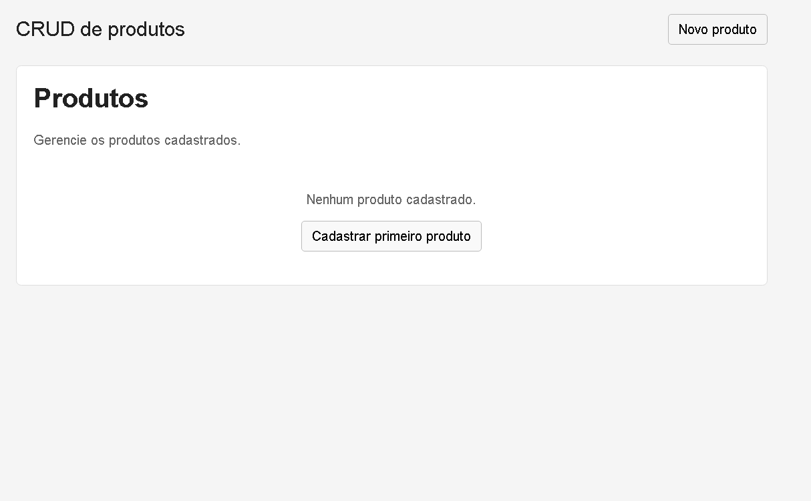

# CRUD básico com Flask

Aplicação CRUD de produtos feita em Python, Flask e SQLite.

## Como executar

1. (Opcional) Crie e ative um ambiente virtual:

   ```powershell
   python -m venv .venv
   .\.venv\Scripts\Activate.ps1
   ```

2. Instale as dependências:

   ```powershell
   pip install -r requirements.txt
   ```

3. Inicie a aplicação:

   ```powershell
   python app.py
   ```

4. Abra http://127.0.0.1:5000 no navegador.

O arquivo `crud.db` é criado automaticamente na primeira execução.

## Testes

```powershell
pytest
```
## Imagens
   ### Página inicial
   
   ### Cadastro de produto
   
   ### Produtos cadastrados
   

## Funcionalidades

- Listar produtos;
- Cadastrar produto;
- Editar produto;
- Excluir produto;
- Validar nome e preço;
- Persistir os dados em SQLite.

